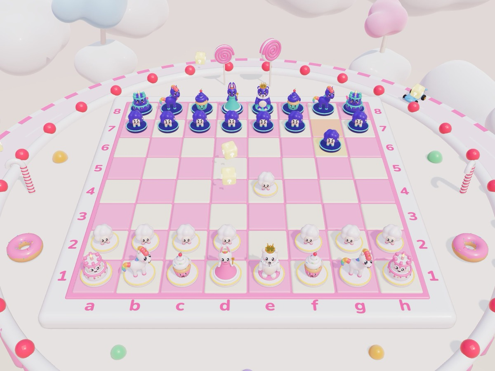
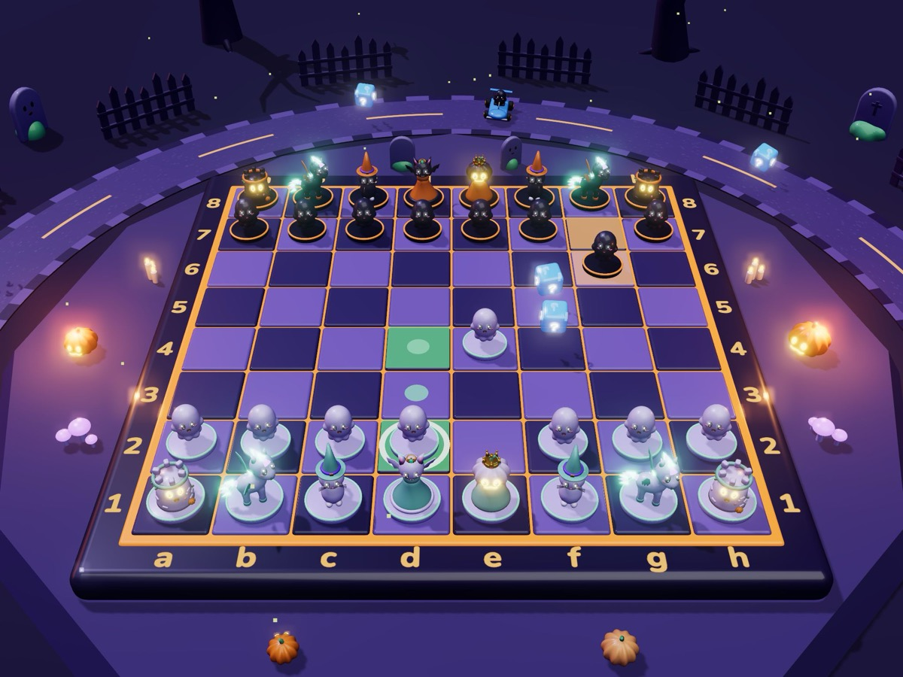
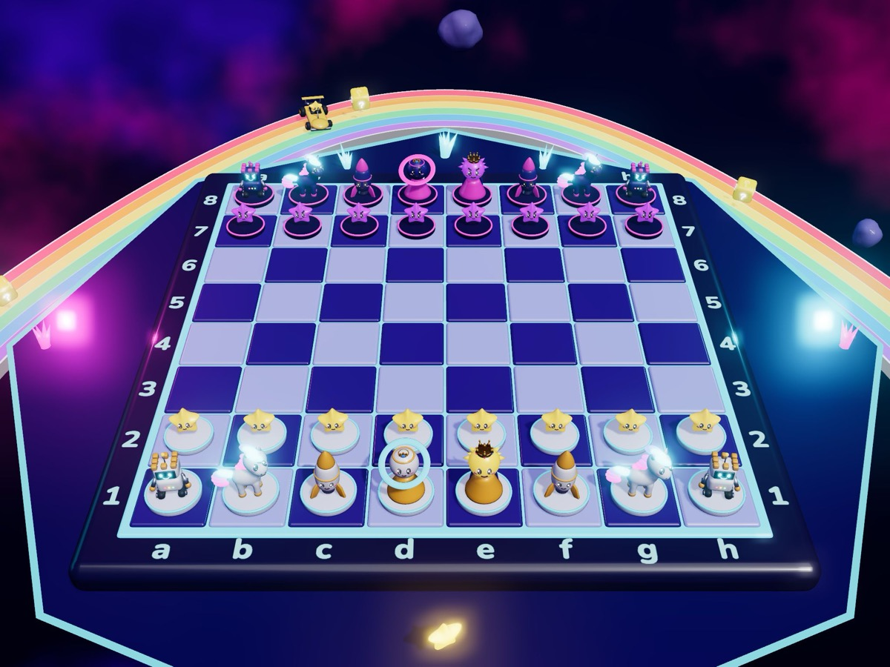
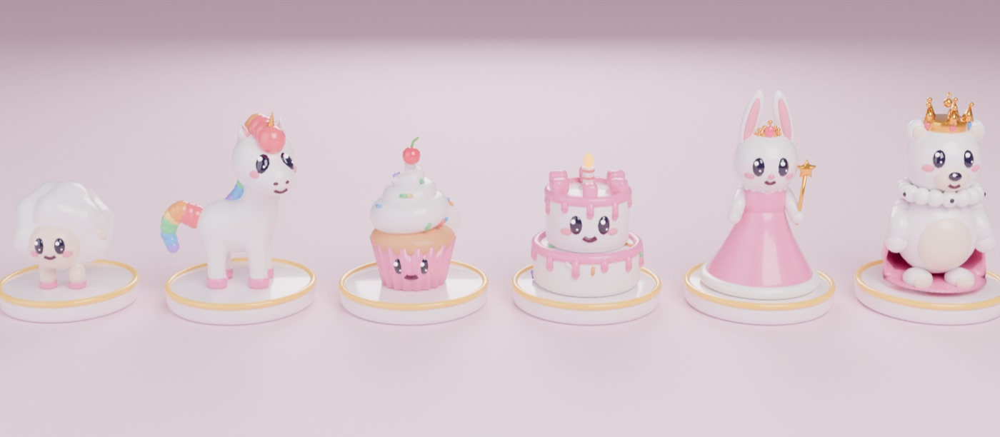
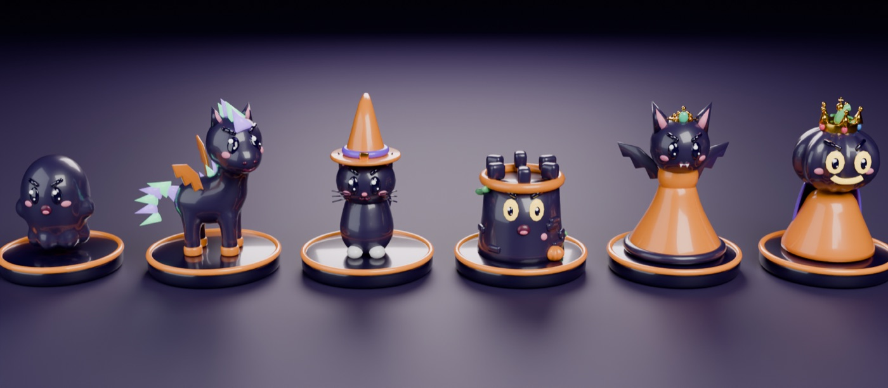
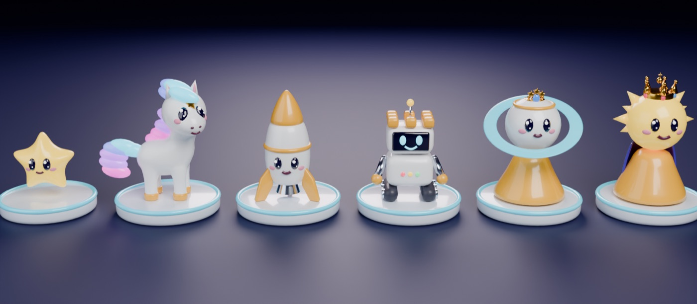

# ROOK & ROLL — kart-style 3D chess

**Play it:** https://markinko202-sys.github.io/rook-n-roll/

Real chess with cute 3D characters, rainbow **?** item boxes and three arenas. Every piece is a hand-built
Blender character, and each arena has its own cast — change the arena and the whole army changes with it.



## What's inside

- **Real chess rules** — check, checkmate, castling, en passant, promotion (you pick the new character), stalemate,
  threefold repetition, the 50-move rule and insufficient material. The move generator passes the standard perft suite.
- **Kart-race twist** — rainbow item boxes appear on the board in mirrored pairs. Land on one and the item roulette spins:
  - 🛡 **Bubble Shield** — one of your pieces can't be captured on the rival's next turn
  - ❄ **Freeze Ray** — an enemy piece can't move on their next turn (the ice melts if it would leave no legal move)
  - 💣 **Bomb** — blow an enemy pawn off the board
  - 🌀 **Warp Swap** — two of your pieces swap places
  - ⚡ **Turbo** — one of your pawns zooms a square forward (it can even promote)

  Items never break chess: they can't attack the king directly and you always keep a legal move.
  Whoever is behind on material rolls stronger items, so comebacks happen. Prefer pure chess? Switch items off.
- **Three arenas, eighteen characters**
  - ☁️ **Candy Clouds** (light) — a strawberry cake above the clouds: cloud-lamb pawns, a rainbow unicorn, a cupcake, a cake tower, the Bunny Queen and the Teddy King
  - 🎃 **Spooky Hollow** (dark) — ghosts, a bat-winged nightmare pony, a witch kitty, a haunted tower, the Bat Queen and the Pumpkin King
  - 🌈 **Rainbow Galaxy** — star kids, a comet pony, a rocket, a robo-rook, the Saturn Queen and the Sun King on a rainbow road through space
- **Computer opponent** on **Easy / Medium / Hard** (alpha-beta search in a Web Worker; Hard looks 10–12 half-moves ahead), or **two players on one screen**.
- **Kart flavour everywhere** — a race track loops around every board with karts driven by pawns, a 3-2-1-GO countdown, knocked-out pieces get bonked onto the bench, Bronze/Silver/Gold cups per arena.
- **Four soundtracks** (menu + one per arena) and every sound effect are synthesised live with the Web Audio API — no audio files.
- **Four languages:** English · Русский · Bahasa Melayu · 中文.
- Works on desktop and phones (tap to move, drag to orbit, pinch to zoom).

| Spooky Hollow | Rainbow Galaxy |
|---|---|
|  |  |





## How to play

Click one of your characters to see where it can go, then click a glowing square. Tap your item slot (top of the screen)
to use an item before your move — one per turn. **Hint** shows a strong move, **Undo** takes your last move back.
Keyboard: `Esc` menu, `H` hint, `Ctrl/⌘+Z` undo.

## Tech

- **Three.js 0.169** (ES modules via an import map, no build step): physically based glossy "vinyl toy" materials,
  reflections from each arena's own sky, soft shadows, bloom, instanced 3D particles.
- **Blender 5 + Python** — every model is generated by script (`blender/pieces.py`, `blender/arenas.py`) and exported as
  Draco-compressed glTF (all assets together ≈ 1.6 MB). Faces are ray-cast onto each head shape so eyes and smiles sit on any form.
- **Chess engine** (`js/chess.js`) — 0x88 board, Zobrist hashing, PeSTO evaluation, iterative deepening, PVS, transposition
  table, null-move pruning, late-move reductions, quiescence search; the items live inside the rules (shield / freeze).
- **Web Audio** synthesiser for music and effects (`js/audio.js`).

### Run locally

```bash
python3 tools/devserver.py 5191 .
```

Then open http://localhost:5191 (`?debug&mute` for a silent debug build with `window.__rnr`).

```bash
node tools/perft.mjs          # move-generator check against the standard perft numbers
node tools/ai_test.mjs 3      # CPU-vs-CPU games with items, every move and item checked for legality
blender -b --python blender/pieces.py -- all render   # rebuild the 18 characters (+ preview renders)
blender -b --python blender/arenas.py -- render       # rebuild arena dressing, item box, kart, item icons
node tools/bump.mjs 2         # cache-busting version on every import before deploying
```

Built by **Artemiy Shepelev**.
